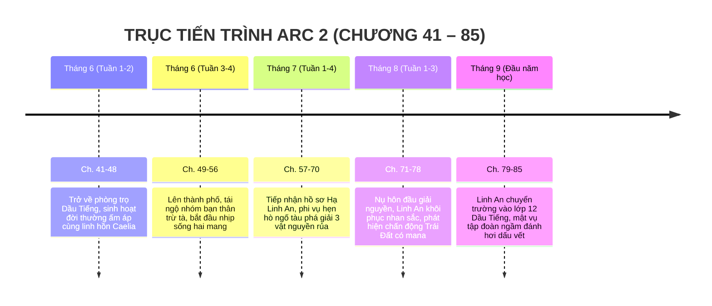

# TIMELINE CHI TIẾT: ARC 2 — TRỞ VỀ & BỨC MÀN HIỆN ĐẠI

> **Vị trí tài liệu:** [outline/timeline/arc_2.md](file:///mnt/E/Study/Syllabus/Orther/Something%20Special/Novel/outline/timeline/arc_2.md)  
> **Quy mô Arc:** Chương 41 – Chương 85 (45 chương).  
> **Không gian tổng thể:** Trái Đất — Thị trấn Dầu Tiếng (Bình Dương), Thành phố Thủ Dầu Một, TP. Hồ Chí Minh.  
> **Thời gian trong truyện:** Khoảng 3 tháng (Đầu Tháng 6 đến Giữa Tháng 9 — Kỳ nghỉ hè chuyển tiếp từ Lớp 11 lên Lớp 12).  
> **Điểm nhìn (POV):** Ngôi thứ 3 giới hạn — Tiêu Trường Sinh (kết hợp các lát cắt góc nhìn của Hạ Linh An).

---

## I. MA TRẬN TIẾN TRÌNH CÁC GIAI ĐOẠN TRONG ARC 2

---

## II. BẢNG MỐC THỜI GIAN & SỰ KIỆN CHI TIẾT

| Mốc thời gian | Không gian / Địa điểm | Diễn biến sự kiện chính | Trạng thái Trường Sinh, Caelia & Linh An | Chương |
| :--- | :--- | :--- | :--- | :--- |
| **Đầu Tháng 6**   *(Ngày 1 – 5)* | Căn phòng trọ Dầu Tiếng, Bình Dương | - Trường Sinh rách rưới rơi trở lại Trái Đất ngay trong căn phòng của mình. - Cảm giác an toàn vỡ òa; việc đầu tiên là tắm nước nóng, ăn một bát mì gói nóng hổi. - Linh hồn Caelia (vầng sáng xanh lá) chui ra từ hốc rỗng, tò mò nhìn ngắm căn phòng, bóng đèn điện và chiếc quạt máy. - Trường Sinh bắt đầu chuỗi ngày "nuôi dưỡng linh hồn": chia sẻ thức ăn (bằng cách hơ qua hơi ấm mana), bật tivi cho Caelia xem phim hoạt hình và phim tài liệu thiên nhiên. | Thể chất hồi phục nhanh chóng nhờ đồ ăn Trái Đất. Mana "Vô" được giấu kín dưới vỏ bọc học sinh 1m70 skinny fat hiền lành. | **Ch. 41 – 48** |
| **Cuối Tháng 6**   *(Ngày 15 – 25)* | Bến xe miền Đông & Khu ngoại ô TP.HCM | - Trường Sinh bắt xe buýt lên thành phố thăm gia đình và mua sắm linh kiện điện tử. - Tình cờ bắt gặp một vụ ẩu đả trong con hẻm tối: Nhóm 3 người bạn thân chí cốt đang bị một nhóm giang hồ tà phái bao vây. - Câu thoại thương hiệu xuất hiện: *"Đánh nhau với người bình thường làm gì chứ!"*. - Trường Sinh vô tình bộc phát một chút kình lực mana "Vô" đấm bay tên cầm đầu cứu bạn. - Nhóm bạn kinh ngạc nhận ra Trường Sinh; tái hợp trong quán ốc vỉa hè; Trường Sinh đồng ý gia nhập nhóm trừ tà đô thị với tư cách "thành viên tự do". | Bắt đầu lối sống hai mang: Ngày ở Dầu Tiếng sống đời học sinh, cuối tuần bắt xe buýt lên thành phố nhận kèo phong thủy / trừ tà kiếm thêm thu nhập. | **Ch. 49 – 56** |
| **Đầu Tháng 7**   *(Ngày 1 – 15)* | Biệt thự họ Hạ (TP.HCM) & Quán cà phê sách | - Nhóm trừ tà nhận được hợp đồng lớn từ một doanh nhân giàu có (cha của Hạ Linh An) cầu cứu chữa bệnh cho con gái. - **Hồ sơ Hạ Linh An:** Từng là tiểu thư xinh đẹp nổi tiếng, nhưng suốt 2 năm lớp 10 và 11 bỗng dưng mắc chứng bệnh lạ khiến da mặt biến dạng, già nua mụn cóc, bị bạn bè xa lánh, rơi vào tự kỷ trầm cảm. - Nhóm phát hiện đây là tà thuật "Tam Trọng Phong Ấn Khóa Nhan" cực kỳ độc địa, chỉ có thể giải bằng sự chân thành tuyệt đối từ một người khác giới không sợ hãi dung mạo của cô. - Cả nhóm thống nhất phân công Trường Sinh: Cậu đóng vai chàng trai "ngố tàu" chủ động tiếp cận, hẹn hò với Linh An theo kịch bản "phím bài" từ bộ đàm của nhóm bạn. | Linh An phòng thủ tuyệt đối, dùng lời lẽ cay độc xua đuổi; Trường Sinh không bỏ chạy vì cậu từng nhìn thấy xác sống Primordia gớm ghiếc hơn gấp trăm lần. | **Ch. 57 – 64** |
| **Giữa Tháng 7 – Đầu Tháng 8**   *(Chiến dịch 7 ngày hẹn hò)* | Công viên bờ sông, Rạp chiếu phim, Tiệm bánh ngọt | - Chuỗi ngày hẹn hò dở khóc dở cười: Các "chiêu thức tán gái" nhóm bạn phím qua tai nghe đều bị Trường Sinh làm hỏng một cách ngây ngô. - Chính sự chân chất, vụng về nhưng kiên định và tôn trọng của Trường Sinh làm tan chảy bức tường băng giá của Linh An. - Từng bước phá vỡ 3 vật định ước phong ấn tà thuật:   1. *Chiếc nhẫn bạc hoen gỉ:* Ném xuống lòng sông khi cô dám mở lòng kể về người bạn thân phản bội.   2. *Con búp bê vải rách:* Bị Trường Sinh dùng mana "Vô" nghiền nát lõi tà khí.   3. *Bức thư đố kỵ độc địa:* Đốt cháy bằng bật lửa kim loại của Trường Sinh. - **Đỉnh điểm giải nguyền:** Đêm trăng trên cầu bộ hành, Trường Sinh nhìn thẳng vào khuôn mặt mụn cóc của Linh An và nói thật lòng: *"Hoa trên đời có hoa đơn sắc, có hoa nhiều màu. Dù có là hoa dại mọc bên đường, nó vẫn có nét đẹp riêng của nó"*. Cậu trao cho cô nụ hôn đầu trong sáng. | Lời nguyền vỡ vụn! Dung nham tà khí tan biến, nhan sắc khuynh thành thực sự của Hạ Linh An bừng nở trở lại. Linh hồn Caelia trong ngực khẽ mỉm cười chúc phúc. | **Ch. 65 – 74** |
| **Giữa Tháng 8**   *(Khám phá chấn động)* | Phòng thí nghiệm riêng của Hạ Linh An | - Hạ Linh An lấy lại sự tự tin, bộc lộ bộ óc thiên tài toán học và công nghệ. - Khi phân tích mẫu tàn dư năng lượng của lá bùa giải nguyền, Linh An phát hiện một dữ liệu chấn động:   *Tà thuật chỉ có thể duy trì nếu có năng lượng môi trường nuôi dưỡng. Điều này chứng minh:* **Trái Đất không hề trơ lì mana, mà đang có một dòng mana bí mật rò rỉ từ từ vào khí quyển!** - Trường Sinh nhớ lại linh kiện chữ `P.` nhặt được ở Primordia, bắt đầu nhận ra mối liên hệ khủng khiếp giữa hai bờ thế giới. | Xác lập liên minh trí tuệ - sức mạnh: Trường Sinh (chiến lực cận chiến) & Linh An (bộ não giải mã). | **Ch. 75 – 78** |
| **Đầu Tháng 9**   *(Mùa tựu trường Lớp 12)* | Trường THPT Dầu Tiếng, Bình Dương | - Tiêu Trường Sinh bước vào năm học lớp 12, tiếp tục muốn làm "học sinh NPC mờ nhạt". - **Bước ngoặt bất ngờ:** Hạ Linh An từ chối các trường quốc tế danh tiếng ở TP.HCM, nộp hồ sơ chuyển trường về Dầu Tiếng và bước vào lớp học, ngồi ngay chiếc bàn cạnh Trường Sinh trong sự ngỡ ngàng của cả trường. - Trong bóng tối, các điệp viên mật vụ thuộc một tập đoàn năng lượng ngầm (Tập đoàn xuyên quốc gia đang lén khai thác mana) đã lần ra các dao động năng lượng bất thường tại Nam Thành và bắt đầu giăng lưới theo dõi. | Trường Sinh xác lập mục tiêu kép vững chắc: Bảo vệ cuộc sống bình yên của người thân, Linh An tại Trái Đất và tìm kiếm phương pháp hồi sinh thể xác cho Caelia. | **Ch. 79 – 85** |

---

## III. DẤU ẤN VÀ BƯỚC NGOẶT ĐỂ BƯỚC VÀO HỒI 2 (ARC 3)

1. **Quan hệ tình cảm:** Tạo dựng mối liên kết sâu sắc, chân thành giữa Trường Sinh và Hạ Linh An; đồng thời linh hồn Caelia chứng kiến tất cả và hòa nhịp gắn bó với cả hai.
2. **Cài cắm xung đột lớn:** Bí mật mana Trái Đất bị Linh An giải mã ➔ Mở đường cho Arc 4 và Arc 5.
3. **Động lực du hành:** Linh hồn Caelia không thể tồn tại vĩnh viễn ở dạng linh thể tại Trái Đất nếu không có thân xác; Trường Sinh cần quay lại Primordia để tìm kiếm Cổ tộc Solavane và bí dược tái tạo sinh mệnh ➔ Đưa nhân vật chính bước vào **Arc 3: Thiết Giáp & Bụi Gai**.
