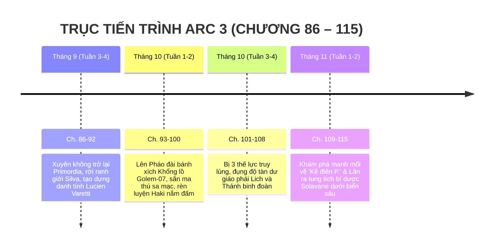

# TIMELINE CHI TIẾT: ARC 3 — THIẾT GIÁP & BỤI GAI

> **Vị trí tài liệu:** [outline/timeline/arc_3.md](file:///mnt/E/Study/Syllabus/Orther/Something%20Special/Novel/outline/timeline/arc_3.md)  
> **Quy mô Arc:** Chương 86 – Chương 115 (30 chương).  
> **Không gian tổng thể:** Primordia — Sa mạc Gai sắt, Đại bình nguyên rỉ sét; Liên bang Pháo đài di động bánh xích Steampunk ma pháp.  
> **Thời gian trong truyện:** Khoảng 2 tháng (Tháng 9 – Tháng 11 năm học Lớp 12).  
> **Điểm nhìn (POV):** Ngôi thứ 3 giới hạn — Tiêu Trường Sinh (dưới thân phận giả Lucien Varetti).

---

## I. TỔNG QUAN BỐI CẢNH & KHUNG THỜI GIAN

---

## II. BẢNG MỐC THỜI GIAN & SỰ KIỆN CHI TIẾT

| Mốc thời gian | Địa điểm cụ thể | Diễn biến sự kiện chính | Trạng thái & Tiến triển nhân vật | Chương |
| :--- | :--- | :--- | :--- | :--- |
| **Cuối Tháng 9**   *(Tuần 1 du hành)* | Ranh giới Siêu đô thị Silva & Bìa sa mạc Gai sắt | - Trường Sinh sạc đầy năng lượng qua các cổng rò rỉ tại Trái Đất, mang theo linh hồn Caelia xuyên không trở lại Primordia. - Khác với lần đầu hoảng loạn, lần này cậu chuẩn bị đầy đủ trang bị thực tế (quần áo dã ngoại, bật lửa kim loại, đồ hộp, linh kiện chữ `P.`). - Rời khỏi vùng phế tích Silva, vượt qua bão cát sa mạc. - Đăng ký thân phận lính đánh thuê tự do với bí danh **Lucien Varetti** để che giấu nguồn gốc Trái Đất. | Thể trạng thích nghi tốt với mana khí quyển nhờ Hirra lọc tạp chất ổn định. Phong thái bình tĩnh, thực dụng hơn. | **Ch. 86 – 92** |
| **Đầu Tháng 10**   *(Tuần 2–3 du hành)* | Pháo đài di động bánh xích Golem-07 (Steampunk Crawler) | - Bước lên siêu pháo đài hơi nước khổng lồ dài 800m chạy trên bánh xích xích sắt; choáng ngợp trước nền văn minh cơ khí ma pháp (nồi hơi mana, súng bắn đá ma tinh, ống khói phun hơi nước). - Tham gia các đội săn ma thú sa mạc (Bò cạp bọc thép, Giun cát ma tinh) để kiếm tiền mua bản đồ và tin tức. - **Tiến triển sức mạnh:** Trường Sinh thử nghiệm nén mana "Vô" sâu hơn, biến nắm đấm thành mũi khoan năng lượng phá giáp kim loại ma thú mà không cần dùng gươm giáo cồng kềnh. | Linh hồn Caelia thường xuất hiện trong phòng kín trò chuyện, chỉ dẫn cậu về địa lý và lịch sử các vương quốc Primordia. | **Ch. 93 – 100** |
| **Cuối Tháng 10**   *(Tuần 4–5 du hành)* | Hẻm núi Bánh Răng & Thị trấn chợ đen pháo đài | - **Xung đột đa phương diện:** Sức mạnh bất thường và món đồ chữ `P.` Trường Sinh mang theo thu hút sự chú ý của 3 thế lực lớn:   1. *Thánh quốc Grimoire:* Nghi ngờ cậu là dị giáo đồ tà thuật.   2. *Quốc gia trung lập Steampunk:* Muốn tước đoạt linh kiện cổ.   3. *Tàn dư Giáo phái Lich:* Lùng sục kẻ đã giết chết Đại Pháp sư Lich ở Silva. - Cuộc rượt đuổi nghẹt thở trên nóc các toa pháo đài hơi nước đang chạy tốc độ cao; Trường Sinh dùng cận chiến nắm đấm đập vỡ khiên ma pháp của kỵ sĩ Thánh binh, tẩu thoát ngoạn mục vào đêm bão cát. | Lần đầu tiên đối đầu trực diện với các pháp sư và kỵ sĩ chính quy Primordia; nhận ra mana "Vô" có khả năng vô hiệu hóa kết cấu phép thuật của đối phương. | **Ch. 101 – 108** |
| **Đầu Tháng 11**   *(Tuần 6 du hành)* | Phế tích Trạm kiểm soát cổ & Bến cảng biển rỉ sét | - Tại một trạm cơ khí bỏ hoang, Trường Sinh tìm thấy nhật ký hải trình của các thợ máy cổ xưa: Nhắc đến một nhà khoa học lập dị tên là **Arthur Pendelton (P.)** từng tuyên bố đã tìm thấy "Đường hầm rốn biển" nối thẳng về thế giới tổ tiên. - Đồng thời, một văn bản ghi chép của cổ tộc Solavane được giải mã: Bí dược hồi sinh xương thịt của gia tộc cổ xưa chỉ có thể hoàn thiện bằng tinh chất *Thần Mộc Đại Dương* nằm sâu dưới rãnh biển sâu Abyss. - Trường Sinh quyết định hướng thẳng ra đại dương Primordia. | Caelia xúc động rơi nước mắt khi biết cậu không hề quên lời hứa tìm lại thân xác thật cho cô. | **Ch. 109 – 115** |

---

## III. DẤU ẤN VÀ BƯỚC CHUYỂN TIẾP

* **Khai mở thế giới rộng lớn:** Rời khỏi không gian khép kín của Silva để bước vào thế giới quan đa chủng tộc, đa công nghệ của Primordia.
* **Cài cắm đầu mối Arc tiếp theo:** Manh mối về biển sâu và di tích cổ dẫn dắt mạch truyện tự nhiên sang **Arc 3A: Thành Phố Dưới Biển** và **Arc 3B: Đảo Người Cá**.
