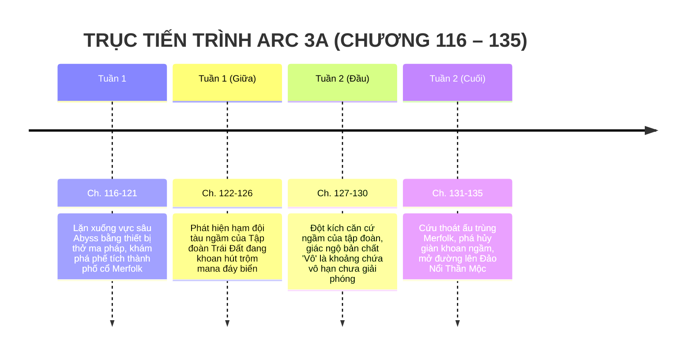

# TIMELINE CHI TIẾT: ARC 3A — THÀNH PHỐ DƯỚI BIỂN

> **Vị trí tài liệu:** [outline/timeline/arc_3a.md](file:///mnt/E/Study/Syllabus/Orther/Something%20Special/Novel/outline/timeline/arc_3a.md)  
> **Quy mô Arc:** Chương 116 – Chương 135 (20 chương).  
> **Không gian tổng thể:** Primordia — Vực sâu không đáy Abyss, Phế tích thành phố ngầm cổ đại của Merfolk (Người Cá).  
> **Thời gian trong truyện:** Khoảng 2 tuần (Tháng 11 năm lớp 12).  
> **Điểm nhìn (POV):** Ngôi thứ 3 giới hạn — Tiêu Trường Sinh.

---

## I. TỔNG QUAN BỐI CẢNH & KHUNG THỜI GIAN

---

## II. BẢNG MỐC THỜI GIAN & SỰ KIỆN CHI TIẾT

| Mốc thời gian | Không gian / Địa điểm | Diễn biến sự kiện chính | Trạng thái nhân vật & Đột phá cảnh giới | Chương |
| :--- | :--- | :--- | :--- | :--- |
| **Giữa Tháng 11**   *(Ngày 1 – 4 lặn biển)* | Vịnh Sương Mù & Vực sâu đại dương Abyss | - Trường Sinh thuê thiết bị lặn cổ xưa chạy bằng đá ma pháp, cùng linh hồn Caelia và Hirra lặn sâu xuống đáy biển Primordia. - Vượt qua vùng áp suất lớn và các quái vật biển sâu dị biến. - Đặt chân vào tàn tích một siêu đô thị ngập nước cổ kính: Cột đá cẩm thạch bám đầy san hô phát quang, những bức tranh tường mô tả sự chung sống hòa bình giữa người trên cạn và Người Cá thời sơ khai. | Hirra thích nghi xuất sắc với môi trường chất lỏng, tạo thành màng bảo vệ áp suất nước quanh cơ thể Trường Sinh. | **Ch. 116 – 121** |
| **Giữa Tháng 11**   *(Ngày 5 – 8 phát hiện)* | Rãnh nứt địa nhiệt ngầm đáy biển | - Bất ngờ phát hiện âm thanh cơ khí hiện đại rền rĩ dưới đáy biển: Tiếng động cơ cánh quạt tàu ngầm công nghệ cao. - **Phát hiện chấn động:** Tàu ngầm mang logo của một tập đoàn tài phiệt năng lượng Trái Đất đang triển khai giàn khoan ngầm cắm sâu vào mạch mana đáy biển Primordia để hút trộm năng lượng đem về Trái Đất. - Chứng kiến cảnh binh lính đánh thuê trang bị súng tự động ngậm đạn ma pháp bắn giết những cư dân Người Cá bảo vệ mạch suối nguồn. | Cơn giận dữ bùng nổ: Nhận ra lòng tham không đáy của giới tư bản Trái Đất chính là nguyên nhân đẩy hai thế giới vào nguy cơ diệt vong. | **Ch. 122 – 126** |
| **Cuối Tháng 11**   *(Ngày 9 – 12 đột kích)* | Giàn khoan khai thác ngầm của Tập đoàn Trái Đất | - Trường Sinh đơn độc đột kích trạm chỉ huy giàn khoan ngầm. - Đối đầu với các sát thủ công nghệ kết hợp ma pháp (Exo-suit bọc giáp titan ma tinh). - **Giác ngộ bản chất "Vô":** Bị dồn vào chân tường dưới áp suất nước cực lớn, Trường Sinh nhận ra: Thuộc tính "Vô" của mình không phải là khoảng trống bất lực hay thiếu hụt, mà là **khoảng chứa vô hạn chưa giải phóng (The Boundless Vessel)**. Cậu có thể hút trọn áp lực của dòng nước biển xung quanh, nén vào nắm đấm và giải phóng ra một cú đấm chân không xé toạc lớp giáp tàu ngầm. | Nắm đấm "Vô" tiến hóa lên tầng thứ hai: Không chỉ nén mana bản thân mà còn có thể mượn và khuếch đại áp lực môi trường xung quanh. | **Ch. 127 – 130** |
| **Cuối Tháng 11**   *(Ngày 13 – 15 giải cứu)* | Cửa hang san hô cổ & Đường hầm dẫn lên đảo | - Trường Sinh phá hủy lò phản ứng hút trộm mana của giàn khoan, giải thoát hàng chục ấu trùng và chiến binh Người Cá bị bắt giam làm vật thí nghiệm. - Các chiến binh Người Cá dù vẫn còn đề phòng con người nhưng trước ân nghĩa cứu tộc của Trường Sinh, họ chấp nhận hộ tống cậu qua rặng đá ngầm cấm kỵ để dẫn lên **Đảo Nổi Thần Mộc**. | Mối quan hệ giữa Trường Sinh và tộc Người Cá mở ra tia hy vọng ngoại giao đầu tiên. | **Ch. 131 – 135** |

---

## III. BƯỚC CHUYỂN TIẾP SANG ARC 3B
Hành trình đưa Trường Sinh từ phế tích đáy biển trồi lên mặt nước tại vùng biển cấm kỵ, chính thức tiếp cận nền văn minh biệt lập của Vương quốc Người Cá trên **Đảo Nổi Thần Mộc (Arc 3B)**.
