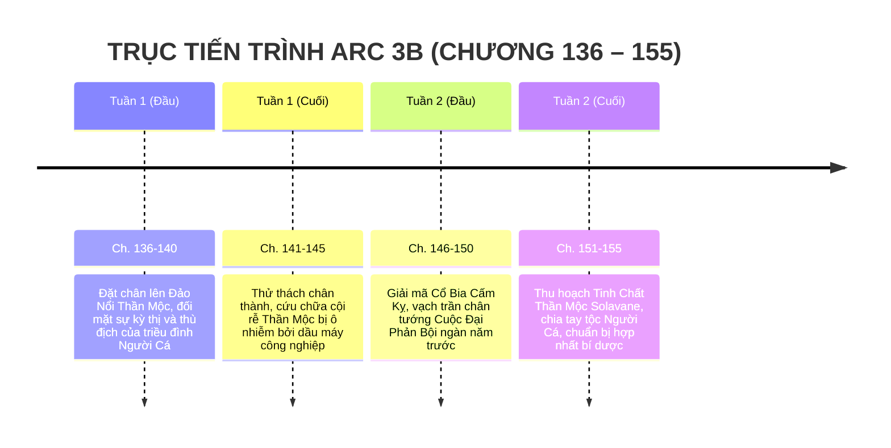

# TIMELINE CHI TIẾT: ARC 3B — ĐẢO NGƯỜI CÁ

> **Vị trí tài liệu:** [outline/timeline/arc_3b.md](file:///mnt/E/Study/Syllabus/Orther/Something%20Special/Novel/outline/timeline/arc_3b.md)  
> **Quy mô Arc:** Chương 136 – Chương 155 (20 chương).  
> **Không gian tổng thể:** Primordia — Đảo Nổi Thần Mộc (Floating Isle of the World-Tree), Vương quốc Merfolk biệt lập.  
> **Thời gian trong truyện:** Khoảng 2 tuần (Đầu Tháng 12 năm lớp 12).  
> **Điểm nhìn (POV):** Ngôi thứ 3 giới hạn — Tiêu Trường Sinh.

---

## I. TỔNG QUAN BỐI CẢNH & KHUNG THỜI GIAN

---

## II. BẢNG MỐC THỜI GIAN & SỰ KIỆN CHI TIẾT

| Mốc thời gian | Địa điểm cụ thể | Diễn biến sự kiện chính | Bước ngoặt cốt truyện & Lore thế giới | Chương |
| :--- | :--- | :--- | :--- | :--- |
| **Đầu Tháng 12**   *(Ngày 1 – 4)* | Cảng Vỏ Sò & Cung Điện San Hô Đảo Nổi | - Trường Sinh bước lên hòn đảo nổi khổng lồ được nâng đỡ bởi rễ của một cây cổ thụ thần thoại giữa biển khơi. - Người Cá bản địa bao vây, giơ mũi giáo đe dọa vì căm ghét "loài người hai chân giả tạo trên cạn". - Dù đã cứu ấu trùng ở đáy biển, Trường Sinh vẫn bị tống giam vào nhà lao san hô chờ Đại hội trưởng lão phán quyết. | Trường Sinh giữ bình tĩnh, tuyệt đối không dùng vũ lực phản kháng, kiên nhẫn chứng minh thiện chí bằng hành động. | **Ch. 136 – 140** |
| **Đầu Tháng 12**   *(Ngày 5 – 8)* | Hốc rễ Thần Mộc trung tâm đảo | - Cội rễ Thần Mộc nuôi sống cả hòn đảo phát bệnh khô héo do bị chất độc dầu máy và hóa chất từ giàn khoan Trái Đất rò rỉ đầu độc. - Các pháp sư Người Cá bất lực vì mana tự nhiên không thể thanh tẩy tạp chất công nghiệp Trái Đất. - Trường Sinh tình nguyện bước vào hốc rễ độc địa: Cậu vận dụng hốc rỗng thuộc tính "Vô" cùng Hirra hút sạch toàn bộ chất độc hóa học vào cơ thể mình, thanh lọc triệt để cho dòng nhựa sống của cây thần. - Hành động liều mình cứu cả vương quốc khiến toàn thể cư dân Người Cá rơi nước mắt quỳ gối kính phục. | Thu phục trọn vẹn lòng tin của chủng tộc cổ xưa; được Nữ hoàng Người Cá phong làm "Người Bạn Của Biển Sâu". | **Ch. 141 – 145** |
| **Giữa Tháng 12**   *(Ngày 9 – 12)* | Đền Thờ Cổ Bia Tối Thượng Thần Mộc | - Trường Sinh và linh hồn Caelia được diện kiến văn bia cấm kỵ được khắc từ Kỷ Đại Phân Tách. - **Hé lộ chân tướng lịch sử:** *"Thuở sơ khai hai thế giới vốn là một thể thống nhất"*. Cuộc Đại Phản Bội xảy ra khi tầng lớp thống trị cướp đoạt Hạch Mana chạy sang lập nên Trái Đất; Người Cá chính là những cư dân trung kiên từ chối bỏ rơi vùng đất mẹ Primordia. - Trường Sinh nhận ra: Bản thân mình sinh ra ở Trái Đất nhưng cơ thể mang hốc rỗng chính là vết tích sót lại của dòng máu cổ sơ chưa bị tha hóa. | Gắn kết nguồn gốc cá nhân của Tiêu Trường Sinh với vận mệnh thống nhất hai thế giới. | **Ch. 146 – 150** |
| **Giữa Tháng 12**   *(Ngày 13 – 15)* | Đỉnh Thần Mộc & Lễ Tiễn Đưa | - Nữ hoàng Người Cá trao tặng Trường Sinh giọt **Tinh Chất Thần Mộc Solavane** — thành phần cốt lõi duy nhất còn thiếu trong bí dược tái tạo thể xác của Cổ tộc Caelia. - Linh hồn Caelia rạng rỡ hy vọng; tuy nhiên bí dược cần phải được tôi luyện và hấp thụ tại một Đền Cổ trên đất liền trước khi kích hoạt hoàn chỉnh. - Trường Sinh từ biệt vương quốc Người Cá, trở lại đất liền Primordia để hướng về Cấm Địa Cổ Thành. | Thu thập vật phẩm then chốt: Tinh chất Thần Mộc Solavane. Mở đường cho cuộc hội ngộ bùng nổ cảm xúc tại **Arc 4**. | **Ch. 151 – 155** |

---

## III. DẤU ẤN VÀ BƯỚC CHUYỂN TIẾP
Kết thúc chuỗi hành trình đại dương, Trường Sinh nắm giữ trong tay thành phần bí dược quý giá nhất, chuẩn bị bước vào cuộc chạy đua nước rút giữa hai thế giới trong **Arc 4: Sự Thật Hạch Mana & Điệu Múa Lửa Trại**.
