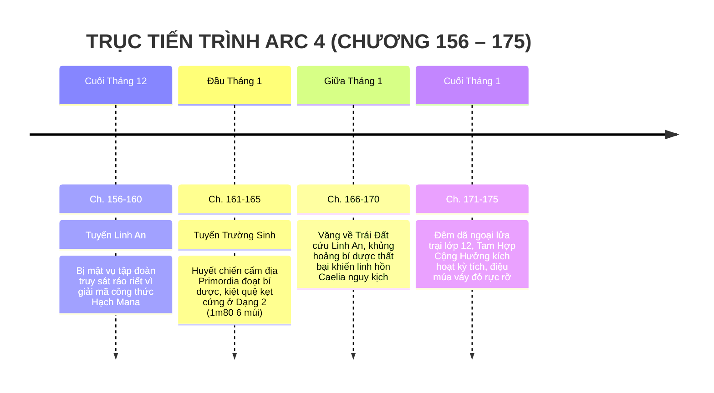

# TIMELINE CHI TIẾT: ARC 4 — SỰ THẬT HẠCH MANA & ĐIỆU MÚA LỬA TRẠI

> **Vị trí tài liệu:** [outline/timeline/arc_4.md](file:///mnt/E/Study/Syllabus/Orther/Something%20Special/Novel/outline/timeline/arc_4.md)  
> **Quy mô Arc:** Chương 156 – Chương 175 (20 chương).  
> **Không gian tổng thể:** Song song hai thế giới:  
> * *Trái Đất:* Phòng thí nghiệm ngầm TP.HCM, Nam Thành & Khu cắm trại rừng thông Đà Lạt / Dầu Tiếng.  
> * *Primordia:* Cấm địa Đền Cổ Solavane (Tàn tích Thung lũng Gió).  
> **Thời gian trong truyện:** Khoảng 1 tháng (Cuối Tháng 12 đến Cuối Tháng 1 — Cuối học kỳ 1 năm Lớp 12).  
> **Điểm nhìn (POV):** Song song hai tuyến: Tuyến độc lập của Hạ Linh An (Trái Đất) & Tuyến Tiêu Trường Sinh (Primordia ➔ Trái Đất).

---

## I. TỔNG QUAN BỐI CẢNH & KHUNG THỜI GIAN

---

## II. BẢNG MỐC THỜI GIAN & SỰ KIỆN CHI TIẾT

| Mốc thời gian | Không gian / Tuyến nhân vật | Diễn biến sự kiện chính | Bước ngoặt & Trạng thái nhân vật | Chương |
| :--- | :--- | :--- | :--- | :--- |
| **Cuối Tháng 12**   *(Tuần 1)* | **Trái Đất:** Viện máy tính & Phố đêm Nam Thành *(Tuyến Linh An)* | - Hạ Linh An bí mật xây dựng mô hình toán học giải mã các dao động trường năng lượng toàn cầu. - **Phát hiện kinh hoàng:** Hạch Mana Trái Đất đang bị rò rỉ nghiêm trọng, nồng độ mana đang tăng theo cấp số nhân; và một liên minh tập đoàn năng lượng ngầm đang cố tình đẩy nhanh quá trình này để trục lợi. - Mật vụ tập đoàn kích hoạt lệnh tiêu diệt nhân chứng; Linh An bị truy đuổi trong đêm mưa bão. - Đứng trước lời đe dọa ép xóa dữ liệu để bảo toàn tính mạng gia tộc, Linh An kiên quyết từ chối: *"Tôi chọn sự thật!"*. Cô dùng trí thông minh lẩn trốn vào các trạm xe buýt cũ. | Linh An bộc lộ bản lĩnh kiên cường, vượt ra khỏi hình bóng tiểu thư được bảo bọc. | **Ch. 156 – 160** |
| **Đầu Tháng 1**   *(Tuần 2)* | **Primordia:** Cấm địa Đền Cổ Solavane *(Tuyến Trường Sinh)* | - Trường Sinh thâm nhập vào đền thờ cấm địa của gia tộc Caelia để tôi luyện bí dược với Tinh chất Thần Mộc. - Đụng độ thủ hộ giả viễn cổ và bẫy ma pháp cuồng loạn; Trường Sinh buộc phải dốc toàn bộ Nguyên Mana và kích hoạt cực hạn năng lượng "Vô" để phá vỡ phong ấn. - Cậu luyện thành bí dược tái tạo sinh mệnh nhưng toàn bộ kinh mạch bị kiệt quệ, tổn thương nghiêm trọng. - Không còn đủ sức kiểm soát cơ bắp và mana để duy trì "Dạng 1 NPC học sinh 1m70 skinny fat", cậu **bị khóa cứng ở Dạng 2: Cao 1m80, cơ bắp cuồn cuộn 6 múi tạc tượng, khí chất áp bức**. - Cơn chấn động không gian hất tung cậu trở lại Trái Đất. | Thể xác thay đổi ngoạn mục ngoài ý muốn; kẹt ở Dạng 2 vạm vỡ, kinh mạch kiệt quệ. | **Ch. 161 – 165** |
| **Giữa Tháng 1**   *(Tuần 3)* | **Trái Đất:** Nhà hoang ngoại ô & Phòng y tế bí mật | - Trường Sinh xuất hiện kịp thời với cú đấm "Vô" uy lực đập tan đội đặc vụ tập đoàn đang bao vây Linh An, cứu cô thoát chết trong gang tấc. - Linh An ngỡ ngàng trước diện mạo mới (1m80, 6 múi) của Trường Sinh nhưng nhận ra ánh mắt chân thành quen thuộc. - **Khủng hoảng Bí Dược:** Trường Sinh cho linh hồn Caelia hấp thụ bí dược nhưng quá trình tái tạo thể xác bị nghẽn lại vì thiếu "nguồn dẫn tần số sinh học"; linh hồn Caelia chập chờn đau đớn, đứng trước nguy cơ tiêu tán hoàn toàn. - Trường Sinh tuyệt vọng gào thét; Linh An thức trắng 3 đêm dùng máy tính phân tích tần số linh hồn của Caelia để tìm giải pháp. | Caelia cận kề ranh giới tiêu biến; Trường Sinh đau đớn cùng cực; Linh An tìm ra chìa khóa: Cần một chất xúc tác nghi thức văn hóa cổ. | **Ch. 166 – 170** |
| **Cuối Tháng 1**   *(Đêm định mệnh)* | **Trái Đất:** Khu dã ngoại đồi thông — Đêm lửa trại học kỳ 1 Lớp 12 | - Cả lớp 12 tổ chức chuyến dã ngoại tổng kết học kỳ 1 bên đống lửa trại rực sáng giữa rừng đêm se lạnh. - **Kỳ tích Tam Hợp Cộng Hưởng:** Khi ngọn lửa trại bốc cao, 3 yếu tố hội tụ đỉnh điểm:   1. *Nỗi đau và ý chí bất khuất của Trường Sinh.*   2. *Phương trình cân bằng sóng linh hồn do Linh An lập trình.*   3. *Điệu múa thiêng liêng Solavane của Caelia.* - Vầng sáng xanh lá bùng nổ: **Caelia ngưng tụ hiện hình rõ nét trong tà váy đỏ rực lộng lẫy!** - Caelia bước ra nắm lấy tay Trường Sinh; hai người hòa mình vào điệu khiêu vũ Solavane rực lửa bên đống lửa trại trước sự chứng kiến và nụ cười rạng rỡ của Linh An. - Thể xác Caelia bắt đầu có nhịp đập sinh học bán phần, linh hồn được cố định vĩnh viễn, thoát khỏi hiểm cảnh phân rã. | Caelia chính thức hiện hình trước thế giới; Tam Hợp Cộng Hưởng xác lập tình cảm keo sơn gắn bó giữa cả ba người. | **Ch. 171 – 175** |

---

## III. DẤU ẤN VÀ BƯỚC CHUYỂN TIẾP SANG ARC 5
Thời khắc hạnh phúc trọn vẹn bên đống lửa trại cũng là lúc những vết rạn nứt không gian khổng lồ bắt đầu chớp nháy trên bầu trời đêm — báo hiệu bức màn ngăn cách giữa hai thực tại sắp sửa sụp đổ toàn diện trong **Arc 5: Vách Ngăn Sụp Đổ**.
