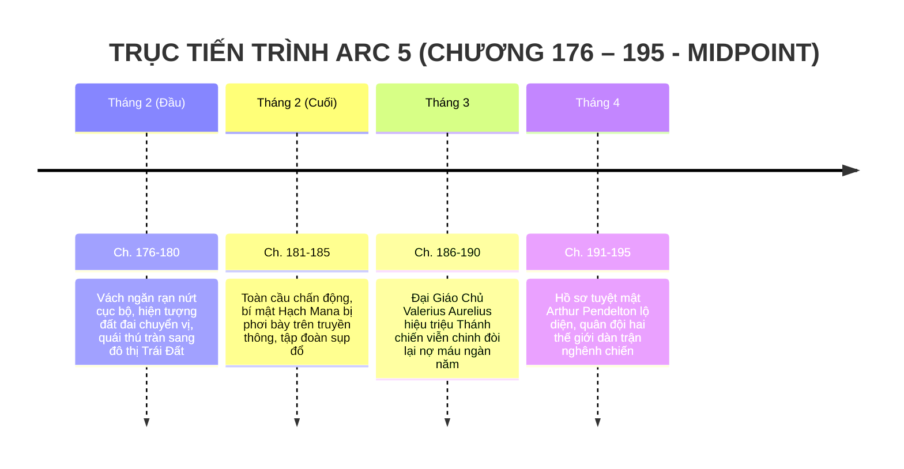

# TIMELINE CHI TIẾT: ARC 5 — VÁCH NGĂN SỤP ĐỔ (MIDPOINT TOÀN TRUYỆN)

> **Vị trí tài liệu:** [outline/timeline/arc_5.md](file:///mnt/E/Study/Syllabus/Orther/Something%20Special/Novel/outline/timeline/arc_5.md)  
> **Quy mô Arc:** Chương 176 – Chương 195 (20 chương).  
> **Vị trí cốt truyện:** Điểm giữa cấu trúc (Midpoint Climax) — Lật ngược toàn bộ thế giới quan và tình thế của tác phẩm.  
> **Không gian tổng thể:** Vùng chồng lấn không gian toàn cầu — Đô thị Trái Đất & Lãnh thổ Primordia bị xé rách đan xen.  
> **Thời gian trong truyện:** Khoảng 3 tháng (Tháng 2 đến Cuối Tháng 4 — Học kỳ 2 năm Lớp 12).  
> **Điểm nhìn (POV):** Đa tuyến xoay quanh Tiêu Trường Sinh, Caelia, Hạ Linh An và Đại Giáo Chủ Valerius Aurelius.

---

## I. TỔNG QUAN BỐI CẢNH & KHUNG THỜI GIAN

---

## II. BẢNG MỐC THỜI GIAN & SỰ KIỆN CHI TIẾT

| Mốc thời gian | Không gian / Chiến trường | Diễn biến sự kiện chính | Bước ngoặt cốt truyện & Căng thẳng kịch tính | Chương |
| :--- | :--- | :--- | :--- | :--- |
| **Đầu Tháng 2**   *(Tuần 1 thảm họa)* | Các thành phố lớn Trái Đất (Nam Thành, TP.HCM, New York, Tokyo) | - Vách ngăn không gian rạn nứt hàng loạt: Từng mảng rừng ma thú, di tích đá cổ Primordia rơi ầm ầm xuống trung tâm đô thị hiện đại. - Quái thú Primordia (Chó săn ma tinh, Bò cạp bọc thép) tràn qua vết nứt tấn công dân thường; súng đạn cảnh sát không xuyên thủng giáp ma tinh. - Đồng thời, một số làng mạc hiền hòa của Primordia rơi xuống Trái Đất đã dùng ma pháp trị liệu cứu chữa người bị thương. - Trường Sinh cùng nhóm bạn trừ tà lao ra đường phố, dùng nắm đấm "Vô" đập tan các ổ quái vật cứu hàng trăm người. | Thế giới trật tự cũ sụp đổ hoàn toàn; nhân loại Trái Đất lần đầu diện kiến sự tồn tại của ma pháp và quái vật. | **Ch. 176 – 180** |
| **Cuối Tháng 2**   *(Tuần 3–4 công bố)* | Mạng truyền thông toàn cầu & Trụ sở Liên Hợp Quốc | - Linh An cùng nhóm hacker công bố toàn bộ tài liệu giải mã Hạch Mana lên mạng Internet toàn cầu: Bóc trần tội ác của các tập đoàn tài phiệt lén hút trộm mana làm rách vách ngăn thế giới. - Làn sóng biểu tình bùng nổ; giới tài phiệt ngầm bị bắt giữ hoặc tháo chạy. - Bầu trời hai thế giới bắt đầu xuất hiện những dải cực quang đỏ tía và tím thẫm đan xen, không thể che giấu được nữa. | Bí mật hai thế giới hoàn toàn công khai trước toàn nhân loại. | **Ch. 181 – 185** |
| **Tháng 3**   *(Hiệu triệu Thánh chiến)* | Primordia: Quảng trường Thánh Điện Grimoire | - **Đại Giáo Chủ Valerius Aurelius** đăng đàn trước hàng vạn kỵ binh và pháp sư Primordia. - Valerius vạch trần tội ác lịch sử của **Cuộc Đại Phản Bội**: *"Những kẻ trộm cắp ở bờ bên kia đã lấy đi suối nguồn sự sống của chúng ta ngàn năm qua, khiến đất đai cằn cỗi và quái vật hoành hành! Đã đến lúc lấy lại những gì thuộc về Thần thánh!"*. - Thánh quốc phát động chiến dịch tổng lực viễn chinh đòi nợ máu lịch sử đối với Trái Đất. - Pháo đài bay và quân đoàn cơ giới Steampunk ầm ầm tiến về ranh giới không gian. | Xung đột mang tính chính nghĩa hai chiều: Nỗi đau của Primordia là thật ("nỗi đau đúng mà sai"), dẫn đến cuộc chiến không thể tránh khỏi. | **Ch. 186 – 190** |
| **Tháng 4**   *(Bàn cờ lộ diện)* | Khu quân sự hóa tiền tuyến & Hầm mật Pendelton | - Linh An và Trường Sinh giải mã thành công một ổ cứng cổ tìm thấy từ linh kiện chữ `P.`: **Hồ sơ tuyệt mật Giáo sư Arthur Pendelton**. - Chân tướng kẻ giật dây: Pendelton không hề chết trong vụ nổ 20 năm trước, mà đang đứng trong bóng tối kích động hai bờ đánh nhau nhằm gom đủ năng lượng kích hoạt cỗ máy khâu vá thực tại. - Quân đội Trái Đất (xe tăng, pháo binh, tiêm kích) và Quân đoàn Primordia chính thức giáp mặt tại ranh giới không gian, đạn đã lên nòng. | Trường Sinh đứng trước quyết định sống còn: Phải ngăn chặn cuộc tàn sát vô nghĩa trước khi Pendelton nuốt chửng cả hai thế giới. | **Ch. 191 – 195** |

---

## III. BƯỚC NGOẶT CHUYỂN TIẾP SANG HỒI 3
Midpoint kết thúc đẩy toàn bộ câu chuyện vào thế nghìn cân treo sợi tóc. Mọi mâu thuẫn cá nhân được nâng tầm thành vận mệnh sinh tồn của hai nền văn minh, mở màn cho **Arc 6: Tiền Tuyến Hai Thế Giới & Bàn Cờ Kẻ Điên**.
