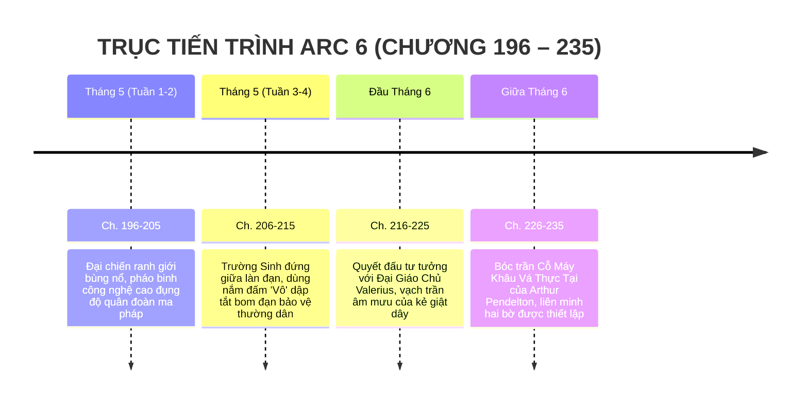

# TIMELINE CHI TIẾT: ARC 6 — TIỀN TUYẾN HAI THẾ GIỚI & BÀN CỜ KẺ ĐIÊN

> **Vị trí tài liệu:** [outline/timeline/arc_6.md](file:///mnt/E/Study/Syllabus/Orther/Something%20Special/Novel/outline/timeline/arc_6.md)  
> **Quy mô Arc:** Chương 196 – Chương 235 (40 chương).  
> **Không gian tổng thể:** Vùng đệm ranh giới không gian chiến sự (Biên giới quân sự hóa giữa Trái Đất và Primordia).  
> **Thời gian trong truyện:** Khoảng 2 tháng (Tháng 5 đến Giữa Tháng 6 — Thời điểm ôn thi tốt nghiệp THPT & Đại chiến ranh giới).  
> **Điểm nhìn (POV):** Tiêu Trường Sinh, Caelia Solavane, Hạ Linh An và Đại Giáo Chủ Valerius Aurelius.

---

## I. TỔNG QUAN BỐI CẢNH & KHUNG THỜI GIAN

---

## II. BẢNG MỐC THỜI GIAN & SỰ KIỆN CHI TIẾT

| Mốc thời gian | Chiến trường / Không gian | Diễn biến sự kiện chính | Bước ngoặt cốt truyện & Triết học tư tưởng | Chương |
| :--- | :--- | :--- | :--- | :--- |
| **Đầu Tháng 5**   *(Đại chiến bùng nổ)* | Vùng bình nguyên đệm biên giới ranh giới hai thế giới | - Tiếng súng pháo mở màn: Pháo tự hành, tên lửa dẫn đường và xe tăng Trái Đất khai hỏa; đối đầu với kỵ binh ma thú, pháo đài hơi nước bánh xích và bão lửa ma pháp của Thánh quốc. - Khói lửa mịt mù ngút trời, cả hai bên đều chịu thương vong nặng nề do sự hiểu lầm và định kiến ngàn năm tích tụ. - Những khu vực dân cư giáp ranh rơi vào biển lửa hỗn loạn. | Hiện thực chiến tranh tàn khốc: Không có bên nào hoàn toàn sai, nhưng lòng thù hận mù quáng đang dẫn cả hai bờ tới diệt vong. | **Ch. 196 – 205** |
| **Giữa Tháng 5**   *(Bức tường thép 'Vô')* | Trọng tâm hỏa lực giữa hai chiến tuyến | - Tiêu Trường Sinh lao vào trung tâm làn đạn trong hình thái Dạng 2 (1m80, 6 múi uy dũng). - Cậu không tấn công binh lính bất kỳ bên nào, mà dùng **Nắm đấm "Vô" nén cực hạn** đánh chặn từng đầu đạn pháo phản lực, đấm vỡ các quả cầu ma pháp cuồng bạo, thiết lập một "vùng cấm chiến tranh" an toàn cho thường dân chạy nạn. - Caelia (trong tà váy đỏ rực) cùng các y sĩ Primordia sơ cứu cho thương binh cả hai phía; Linh An dùng vệ tinh gây nhiễu sóng hệ thống phóng tên lửa tầm xa. | Khẳng định bản lĩnh và lý tưởng của Trường Sinh: Kẻ mạnh không dùng nắm đấm để thống trị, mà dùng nắm đấm để ngăn chặn bi kịch. | **Ch. 206 – 215** |
| **Đầu Tháng 6**   *(Đối đầu Giáo Chủ)* | Kỳ hạm bay Thánh Điện Grimoire | - Trường Sinh đơn thương độc mã nhảy lên kỳ hạm của Đại Giáo Chủ Valerius Aurelius. - **Quyết đấu đỉnh cao:** Ma pháp Thần Thánh tối thượng của Valerius đối đầu Nắm đấm "Vô" áp chế của Trường Sinh. - Trường Sinh đánh gãy quyền trượng nhưng không đoạt mạng Valerius; cậu đưa ra chứng cứ lịch sử từ Cổ Bia Người Cá và vạch trần nỗi đau của vị giáo chủ: *"Ta hiểu ngài hận vì dân tộc ngài đã chịu khổ 20 năm qua. Nhưng thảm sát thêm hàng triệu mạng người vô tội ở bờ bên kia không làm người đã chết sống lại!"*. - Valerius bàng hoàng thức tỉnh, ra lệnh toàn quân ngừng bắn. | Chuyển biến tâm lý sâu sắc của Valerius: Từ kẻ phát động chiến tranh trở thành đồng minh thức tỉnh. | **Ch. 216 – 225** |
| **Giữa Tháng 6**   *(Bàn cờ Arthur Pendelton)* | Lòng núi ngầm ranh giới không gian | - Dù chiến trường ngừng bắn, mặt đất vẫn rung chuyển dữ dội. - Linh An phát hiện một nguồn hút năng lượng khổng lồ: **Cỗ máy Khâu Vá Thực Tại (The Reality Seam-Weaver)** vĩ mô của Arthur Pendelton đang âm thầm hấp thụ toàn bộ oán khí và năng lượng ma pháp vừa tiêu hao trên chiến trường. - Hình bóng Arthur Pendelton xuất hiện qua màn chiếu năng lượng: Tuyên bố thời khắc "thanh lọc và hợp nhất cưỡng bức" đã điểm. - Toàn bộ quân đội hai bên đồng lòng liên minh dưới sự chỉ huy của Trường Sinh, Valerius và Linh An, chuẩn bị tổng tiến công vào tâm chấn cỗ máy. | Thiết lập mặt trận thống nhất hai thế giới, mở đường cho trận chiến quyết định trong **Arc 7**. | **Ch. 226 – 235** |

---

## III. DẤU ẤN VÀ BƯỚC CHUYỂN TIẾP SANG ARC 7
Toàn bộ binh lực hai thế giới buông bỏ hiềm khích, đứng chung một chiến hào hướng về Lõi Không Gian, mở ra hồi kết tráng lệ nhất của thiên sử thi trong **Arc 7: Đại Hợp Nhất & Bản Tình Ca Khởi Nguyên**.
