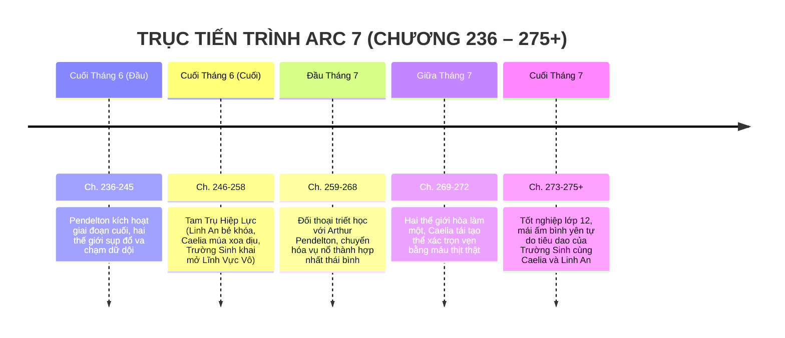

# TIMELINE CHI TIẾT: ARC 7 — ĐẠI HỢP NHẤT & BẢN TÌNH CA KHỞI NGUYÊN (ĐẠI KẾT CỤC)

> **Vị trí tài liệu:** [outline/timeline/arc_7.md](file:///mnt/E/Study/Syllabus/Orther/Something%20Special/Novel/outline/timeline/arc_7.md)  
> **Quy mô Arc:** Chương 236 – Chương 275+ (40+ chương).  
> **Không gian tổng thể:** Tâm điểm Lõi Không Gian Sáp Nhập (The Singularity Crucible) & Hành tinh Thống Nhất mới (Tân Sinh Giới).  
> **Thời gian trong truyện:** Cuối Tháng 6 đến Cuối Tháng 7 (Kỳ thi tốt nghiệp THPT khép lại & Bình minh Kỷ nguyên mới).  
> **Điểm nhìn (POV):** Tiêu Trường Sinh, Caelia Solavane, Hạ Linh An và Arthur Pendelton.

---

## I. TỔNG QUAN BỐI CẢNH & KHUNG THỜI GIAN

---

## II. BẢNG MỐC THỜI GIAN & SỰ KIỆN CHI TIẾT

| Mốc thời gian | Không gian / Chiến trường | Diễn biến sự kiện chính | Bước ngoặt & Ý nghĩa cao trào | Chương |
| :--- | :--- | :--- | :--- | :--- |
| **Cuối Tháng 6**   *(Thời khắc sụp đổ)* | Tâm điểm Lõi Sụp Đổ Không Gian | - Arthur Pendelton nhấn nút kích hoạt cỗ máy: Vách ngăn không gian bị xé nát hoàn toàn. - Hai thực tại lao vào nhau với vận tốc khủng khiếp; trọng lực đảo lộn, bầu trời nứt toác thành hàng vạn mảnh vỡ pha lê rực sáng. - Nguy cơ hai thế giới nghiền nát lẫn nhau thành cát bụi vũ trụ nếu không có lực đệm dung hòa. | Tình thế tuyệt vọng tột cùng: Khoa học công nghệ thuần túy không cứu được, ma pháp nguyên tố thuần túy cũng bất lực. | **Ch. 236 – 245** |
| **Cuối Tháng 6**   *(Tam Trụ Hiệp Lực)* | Đỉnh Cột Trụ Không Gian Khởi Nguyên | - **Phối hợp chiến lược đỉnh cao của 3 nhân vật chính:**   1. **Hạ Linh An (Nhà Phân Tích / The Codebreaker):** Đột nhập trực tiếp vào hệ thống lõi cỗ máy, giải mã thành công chuỗi phương trình hỗn số của Pendelton, tìm ra điểm can thiệp để triệt tiêu năng lượng xung kích.   2. **Caelia Solavane (Người Chữa Lành / The Harmonizer):** Đứng trên đỉnh cao nhất của thực tại, thi triển điệu múa thiêng tối thượng của Cổ tộc Solavane, phóng xuất dải lụa ánh sáng xoa dịu các cơn bão mana cuồng nộ trong khí quyển toàn cầu.   3. **Tiêu Trường Sinh (Cầu Nối Tuyệt Đối / The Balancer):** Khai mở cực hạn bản chất thuộc tính "Vô" cùng sinh linh Hirra, biến hốc rỗng của mình thành một Lĩnh Vực Cân Bằng vô tận bao bọc lấy toàn bộ vết nứt giao thoa. | Ba người trở thành kiềng ba chân vững chắc cứu vãn cả hai nền văn minh; không ai là gánh nặng, ai cũng có vai trò không thể thay thế. | **Ch. 246 – 258** |
| **Đầu Tháng 7**   *(Đối thoại triết học)* | Không gian ý thức tĩnh lặng bên trong Lõi | - Trường Sinh bước vào trung tâm điều khiển đối mặt trực diện với Giáo sư Arthur Pendelton. - Không có sự thù ghét hay giết chóc, chỉ có cuộc đối thoại sâu sắc giữa hai thế hệ:   *Pendelton:* Muốn dùng sức mạnh vĩ mô để sửa chữa sai lầm lịch sử một cách cưỡng ép, chấp nhận hy sinh hàng triệu sinh mệnh nhỏ bé.   *Trường Sinh:* Dùng hành trình cứu từng con người cụ thể (Caelia, Linh An, những người dân thường) để chứng minh: *"Một thế giới mới không thể được dựng xây trên sự dẫm đạp lên từng giọt nước mắt cụ thể"*. Pendelton nhận ra sai lầm, mỉm cười buông tay trao quyền kiểm soát cỗ máy cho Linh An. | Nâng tầm tư tưởng tác phẩm: Giá trị nhân đạo cốt lõi của Tiêu Trường Sinh đánh bại sự điên rồ của chủ nghĩa duy ý chí. | **Ch. 259 – 268** |
| **Giữa Tháng 7**   *(Bình minh Kỷ nguyên mới)* | Tân Sinh Giới (Hành tinh thống nhất mới) | - Năng lượng hai thế giới hòa quyện êm dịu: Primordia và Trái Đất sáp nhập thành công thành một hành tinh thống nhất mới trù phú, màu mỡ. - Cực quang bừng sáng trên bầu trời xanh ngắt trong trẻo. - **Kỳ tích Tái Tạo Thể Xác:** Nhựa sống Thần Mộc, mana "Vô" thuần khiết và tình yêu chân thành hội tụ; vầng sáng xanh lá tan biến, **Caelia Solavane chính thức tái sinh hoàn chỉnh bằng xương thịt, da dẻ ấm áp và trái tim đập rộn ràng**. Cậu ôm chặt lấy cô trong nước mắt. | Lời hứa trọn vẹn từ Arc 1 được thực hiện; Caelia không còn là linh hồn phiêu bạt mà có thể chạm vào cuộc đời thật. | **Ch. 269 – 272** |
| **Cuối Tháng 7**   *(Đại kết cục viên mãn)* | Ngôi nhà ven vườn cao su Dầu Tiếng & Bầu trời thái bình | - Kỳ thi tốt nghiệp THPT khép lại trong yên bình; thế giới bước vào kỷ nguyên giao lưu hòa hợp giữa công nghệ và ma pháp. - Tiêu Trường Sinh từ chối các danh vọng quyền lực tối cao, quay trở về căn nhà ấm cúng tại quê nhà Dầu Tiếng. - Caelia yêu thích việc làm vườn, học nấu các món ăn Trái Đất; Linh An tiếp tục nghiên cứu khoa học song hành cùng cậu. - Cảnh kết: Chiều tà nắng ấm, Trường Sinh ngồi trên hiên nhà, ngắm nhìn Caelia đang múa nhẹ nhàng giữa vườn hoa và Linh An đang mỉm cười ghi chép bên bàn gỗ; Hirra bay lượn vui đùa trên vai cậu. Một cuộc đời tự do tự tại, viên mãn bắt đầu. | Khép lại toàn bộ tác phẩm trong dư âm ngọt ngào, ấm áp, sâu sắc và trọn vẹn. | **Ch. 273 – 275+** |

---

## III. TỔNG KẾT HÀNH TRÌNH TÁC PHẨM
Toàn bộ 8 Arc của **Vọng Âm Thực Tại** hoàn thành một vòng tuần hoàn trọn vẹn: Khởi đầu từ vết thương cô độc và hoang tàn tại Siêu đô thị Silva, trải qua thử thách giữa hai thực tại, thăng hoa bằng tình yêu và sự thấu hiểu, và kết thúc bằng một hành tinh hòa bình cùng mái ấm hạnh phúc của Tiêu Trường Sinh, Caelia và Linh An.
